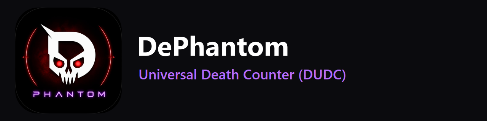

# Universal Death Counter



A free, open-source death counter for Soulslike games, challenge runs, speedruns, and literally any PC game. Built for streamers, challenge runners, and masochists who need to know exactly how many times Malenia has humbled them.


---

## Features

- **Manual death counting** — works with *any* game, no memory reading or injection required
- **Automatic death detection (Windows)** — add a game straight from its `.exe` and the app watches its window for the death screen, counting each death for you. It switches to the right game when you launch it. Teach it any game's death screen in seconds (`F8` on the death screen, or **📷 Death Screen** afterwards to pick it from the last few seconds), save several if some deaths are missed, or use the zero-setup **Souls preset** for Elden Ring, Dark Souls I–III and Sekiro. Screen capture only, so it's safe with anti-cheat
- **Session + Total counters** — track a single run and your all-time total separately
- **Full CRUD freedom** — create, rename, and delete any game or boss at any time; nothing is locked in
- **Quick-Add templates** — one click adds a popular game (Elden Ring, Dark Souls III, Sekiro, Bloodborne, Hollow Knight, Cuphead) with its full boss list pre-filled — then edit/rename/delete freely
- **Set an exact count** — correct the session or total death count directly instead of clicking +1 dozens of times
- **Session history** — review every past run per game, with per-session death counts and one-click delete
- **Backup & restore** — export all your data to a single JSON file and import it back (or onto another PC) anytime
- **Clear all data** — full reset in one confirmed action, with settings preserved
- **Global hotkeys** — `F9` (+1), `F10` (-1), `F11` (Undo), `Ctrl+F12` (Toggle Overlay), `F8` (Calibrate death screen), `Ctrl+F8` (Pause/resume auto-detect) work even while your game is focused, and the buttons always show your current bindings.
- **Controller bindings (Xbox, PlayStation, and most other gamepads)** — bind any action to a button combo such as View/Share + D-pad Up under **Settings → Controls**: click **Record**, press the combo, done. One binding works on both Xbox and PlayStation pads. No extra drivers or libraries, since it uses Windows' built-in XInput and game-controller APIs They use Windows' own hotkey API (no keyboard hook), so they only ever see their own key combos
- **OBS-ready overlay** — transparent, frameless, resizable, movable window for Window Capture — **plus a chroma-key green mode** for color-key filters
- **Overlay customization** — pick the counter color, font size, which number the big counter shows (session / boss / total), and toggle each line (game, boss, stats) on or off
- **deaths.txt for OBS Text Sources** — writes a fully customizable template like `{game} - {boss}: {deaths}` to a text file on every change, so streamers can skip window capture entirely
- **Boss victories** — mark any boss as Defeated ✓ and the app records your "deaths until victory" forever
- **Death notes** — attach a note to any individual death ("fell off cliff", "phase 2 grab") via the Death Log
- **Statistics & graphs** — most/least deaths per boss, average deaths per boss, victories, plus **Qt Charts graphs**: deaths per boss, cumulative deaths over time, and per-session trend
- **CSV export** — spreadsheet-friendly summary of every boss and game total
- **Multiple profiles** — completely separate databases (e.g. "Main Runs" vs "Co-op Nights"), switchable live from the Profile menu
- **System tray** — minimize to tray with quick actions (+1, -1, Undo, Toggle Overlay) one right-click away
- **Update check** — quietly checks GitHub Releases on startup and notifies you when a new version is out (can be disabled)
- **Dark & Light themes** — modern Steam/Discord/Windows 11–inspired UI, easy to extend with more themes
- **Autosave** — every action is written to SQLite immediately, no save button needed
- **Fully local** — your data lives in a local SQLite file, nothing is sent anywhere
- **Windows installer** — auto-built by CI into a real `Setup.exe`, no Python required to run it

## Screenshots

> _Add screenshots of the main window, overlay, and statistics dialog here once available._

| Main Window | OBS Overlay |
|---|---|
| `docs/screenshot-main.png` | `docs/screenshot-overlay.png` |

## Installation

### Option 1 — Download the Windows installer (easiest)

Every push to `main` automatically builds a Windows installer via GitHub Actions.

1. Go to the repo's **Actions** tab → latest successful **Build Windows Executable** run → download the `UniversalDeathCounter-Setup` artifact (or, for tagged versions, grab `UniversalDeathCounterSetup.exe` from the **Releases** page).
2. Run `UniversalDeathCounterSetup.exe` and follow the wizard.
3. Launch **Universal Death Counter** from the Start Menu or desktop shortcut, like any other installed app.

No Python required — this is a fully self-contained installer.

### Option 2 — Build the .exe yourself (on Windows)

```bash
git clone https://github.com/<your-username>/UniversalDeathCounter.git
cd UniversalDeathCounter
python -m venv venv
venv\Scripts\activate
pip install -r requirements.txt

# Build the standalone .exe
pyinstaller packaging\UniversalDeathCounter.spec
# -> dist\UniversalDeathCounter\UniversalDeathCounter.exe (folder build)

# Optional: build the full installer too (requires Inno Setup 6: https://jrsoftware.org/isinfo.php)
iscc packaging\installer.iss
# -> dist_installer\UniversalDeathCounterSetup.exe
```

### Option 3 — Run from source (any OS)

#### Requirements

- Python 3.12+
- Windows, macOS, or Linux (global hotkeys and auto-detection are Windows-only; see [Known Limitations](#known-limitations))

```bash
git clone https://github.com/<your-username>/UniversalDeathCounter.git
cd UniversalDeathCounter
python -m venv venv
source venv/bin/activate      # Windows: venv\Scripts\activate
pip install -r requirements.txt
python -m src.app
```

## Usage

1. Open **Manage → Games & Bosses…** to create your first game — type a name, or hit **Quick-Add Template** for an instant Elden Ring / Dark Souls III / Sekiro / Bloodborne / Hollow Knight / Cuphead setup.
2. Double-click any game or boss in that dialog to rename it; delete buttons remove it (and its history) entirely. Nothing is permanent until you want it to be.
3. Select your game/boss from the dropdowns on the main window.
4. Hit **+1 Death** (or `F9`) every time you die. `F10` decrements, `F11` undoes the last action, and **Set Exact Count…** lets you jump straight to a specific number.
   - **Or let the app count for you:** in the **Game** dropdown choose **+ Add game from .exe…** and pick the game's `.exe`. The name is read from the exe, and detection is set up right away. Souls games use the built-in preset immediately. For any other game, teach it the death screen the first time you die, in one of two ways:
     - Press `F8` while the death screen is showing.
     - Afterwards, click **📷 Death Screen…**, pick the frame from the last few seconds, and drag a box around the death text. You can also load a screenshot file or paste one, e.g. from Win+Shift+S.
   - If a death is ever missed, use **📷 Death Screen…** again. It saves another death screen (any saved one counts) and can add the missed +1.
   - When you launch a configured game, the app switches to it automatically and starts a fresh session; closing the game ends that session. So **Session** always means "this play session".
   - Cutscenes, co-op, or watching someone else play? **⏸ Pause** (or `Ctrl+F8`) stops auto-detection until you resume.
   - The app reopens on the game and boss you used last.
   - Run games in **borderless or windowed** mode, since exclusive fullscreen can capture as black. **Auto-Detect…** (also under **Manage → Auto Death Detection…**) changes the exe, the method, the saved death screens, and the cooldown.
5. Beat a boss? Select it in **Manage → Games & Bosses…** and hit **Toggle Defeated ✓** — your "deaths until victory" number is captured permanently.
6. Open **Manage → Games & Bosses… → Session History** to review or delete individual past runs for a game.
7. Open **View → Toggle Overlay** (or `Ctrl+F12`) and add it as a **Window Capture** source in OBS — or switch the overlay to **chroma** mode in Settings and use a Color Key filter. Prefer text? Enable **deaths.txt** in Settings and point an OBS **Text Source** at the file, with your own `{game} - {boss}: {deaths}` template.
8. Check **View → Statistics & Graphs…** for your per-boss breakdown, victories, and three charts (deaths per boss, deaths over time, per-session trend). **View → Death Log…** lets you attach a note to any individual death.
9. Use the **Profile** menu to create fully separate databases (e.g. a co-op profile) and switch between them instantly.
10. Use **File → Export Backup (JSON)** to save all your data, **File → Import Backup (JSON)** to restore it, and **File → Export CSV Summary…** for a spreadsheet-friendly report. **File → Clear All Data** wipes the current profile if you want a fresh start.
11. Customize theme, tray behavior, and every overlay/streaming option under **Settings → Preferences… → General**. Enable *Minimize to system tray* to keep counting via hotkeys with the window hidden.
12. Under **Settings → Preferences… → Controls**, rebind every action:
    - **Keyboard:** click a field and press a key; **✕** unbinds it.
    - **Controller:** click **Record**, hold a button combo, and release.
    - Controller presses also reach the game, so use a combo, e.g. View/Share + D-pad Up.
    - Duplicate bindings are caught when you save, and **Reset to Defaults** restores the original keys.

## Project Structure

```
UniversalDeathCounter/
├── src/
│   ├── app.py                  # Entry point
│   ├── core/                   # Counter, session, and statistics logic
│   ├── database/                # SQLite access layer (single source of SQL)
│   ├── models/                  # Game / Boss dataclasses
│   ├── ui/                      # Main window, settings, boss manager, session history, about
│   ├── overlay/                  # OBS-ready transparent overlay
│   ├── hotkeys/                 # Global hotkey listener
│   ├── detection/               # Auto death detection: window capture, matchers, watcher thread
│   ├── themes/                   # Dark/Light QSS stylesheets + loader
│   └── utils/                    # Constants, logging, game templates
├── packaging/                    # PyInstaller spec + Inno Setup installer script
├── .github/workflows/            # CI: auto-builds the Windows .exe/installer
├── assets/                      # Icons, fonts
├── saves/                       # SQLite DB + logs (gitignored)
├── tests/                       # pytest unit tests
├── docs/                        # Screenshots, extra docs
├── requirements.txt
└── LICENSE
```

### Architecture notes

- **Event-sourced death counting.** Rather than storing a single mutable counter, every `+1`/`-1` — and every "set exact count" correction — is appended to a `death_events` table with a signed `delta`. Totals, session counts, and undo are all derived by aggregating this log. This gives accurate undo, a full audit trail, and makes backup/export trivial — no schema changes needed.
- **Single SQL boundary.** `src/database/database.py` is the only module that writes raw SQL. `CounterManager`, `SessionManager`, and `StatisticsService` build on top of it, so the data layer can be swapped (e.g. for PostgreSQL in a future sync feature) without touching business logic.
- **Hotkeys are decoupled from the UI.** `HotkeyManager` emits Qt signals; both the on-screen buttons and global hotkeys call the exact same `CounterManager` methods, so behavior is always consistent.
- **Persistent data survives packaging.** When run as a frozen PyInstaller executable, the SQLite database and logs are stored next to the `.exe` (or in the OS's per-user app-data folder if that location isn't writable) rather than in PyInstaller's temporary extraction directory — otherwise every session would lose its history on exit.
- **Plugin-ready by design.** v1.0 is 100% manual input, but the manager classes (`CounterManager`, `Database`) expose everything a future automatic-detection plugin (OCR, memory reading, Steam/Discord integration) would need to call into — without changing this code.

## Roadmap

### v1.0
- [x] Manual counter (+1 / -1 / Undo)
- [x] Games & Bosses management
- [x] OBS overlay
- [x] Global hotkeys
- [x] Statistics
- [x] SQLite persistence

### v1.1
- [x] Rename any game or boss at any time
- [x] Quick-Add game/boss templates (Elden Ring, Dark Souls III, Sekiro, Bloodborne, Hollow Knight, Cuphead)
- [x] Set an exact session/total death count
- [x] Session history viewer with per-session delete
- [x] JSON backup export / import (merge or replace)
- [x] Clear-all-data reset
- [x] Windows installer via PyInstaller + Inno Setup, auto-built by CI

### v1.5 (current)
- [x] Chroma-key green overlay mode for OBS color-key filters
- [x] Overlay customization: counter color, counter source (session/boss/total), show/hide lines
- [x] deaths.txt output with customizable template for OBS Text Sources
- [x] Boss Defeated ✓ tracking with "deaths until victory"
- [x] Notes on individual deaths (Death Log)
- [x] Graphs: deaths per boss, cumulative deaths over time, per-session trend (Qt Charts)
- [x] CSV summary export
- [x] Multiple profiles (separate databases)
- [x] System tray with quick actions + minimize-to-tray
- [x] Startup update check via GitHub Releases

### Next
- [x] Automatic death detection: per-game `.exe`, one-time calibration for any game, Souls preset

### Future
- [ ] Additional themes

### v2.0
- [ ] Formal plugin API for memory reading, Steam, and Discord Rich Presence integrations

## Contributing

Contributions are very welcome!

1. Fork the repo and create a feature branch (`git checkout -b feature/my-feature`)
2. Keep changes modular — one concern per module, matching the existing structure
3. Run `pre-commit install` once so every commit is checked for leftover merge-conflict markers and lint errors (CI runs the same checks)
4. Add or update tests in `tests/` for any logic changes (`pytest`)
5. Follow PEP 8, use type hints and docstrings (see existing modules for the expected style)
6. Open a pull request describing your change and why it's useful

Bug reports and feature requests are just as valuable as code — please open an issue.

## Known Limitations

- Global hotkeys are **Windows-only**. A registered hotkey is consumed, so the game doesn't also receive that key. If another program has already registered a combo (plain `F12` is often taken), the app shows a notice and you can pick a different key in **Settings → Preferences**. The in-app buttons always work.
- Automatic death detection is **Windows-only** and relies on a visible death screen: games running in exclusive fullscreen may capture as black (use borderless/windowed), and games without a consistent death screen can't be auto-detected, so keep using the hotkeys there. The Souls preset is a color heuristic; if it misfires in a game, calibrate that game instead.

## License

This project is licensed under the [MIT License](LICENSE).
