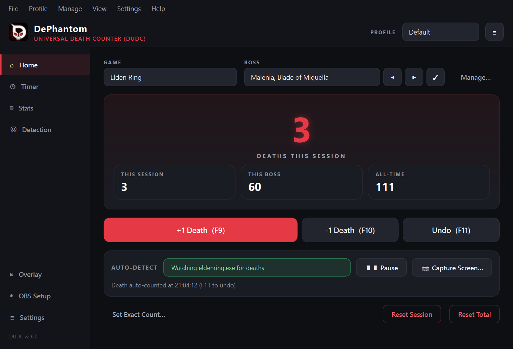
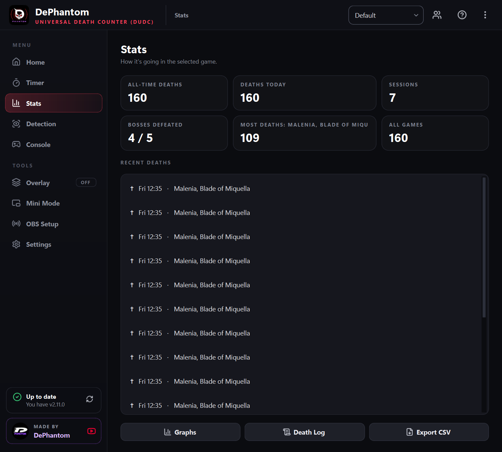
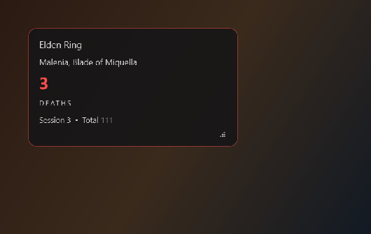
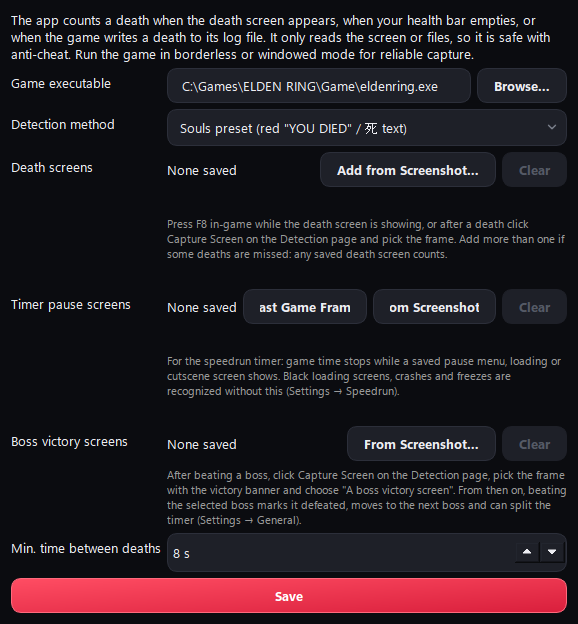
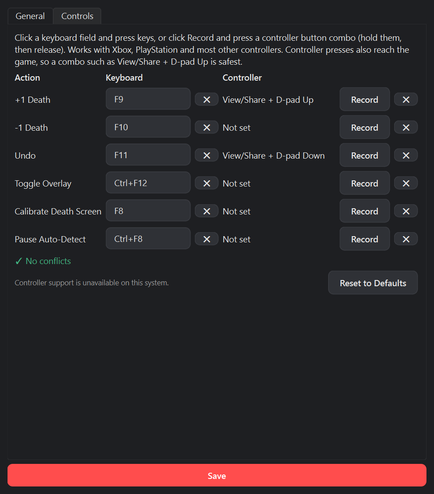
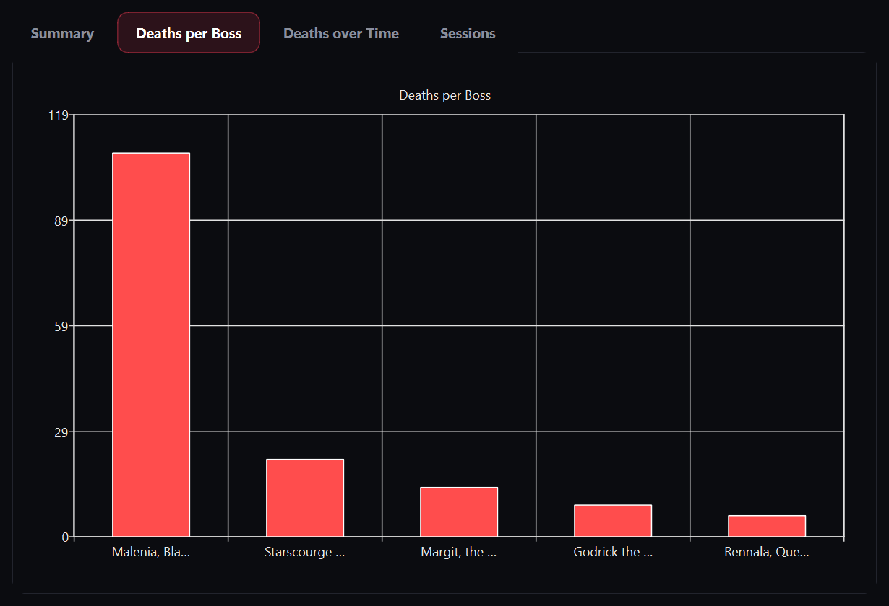
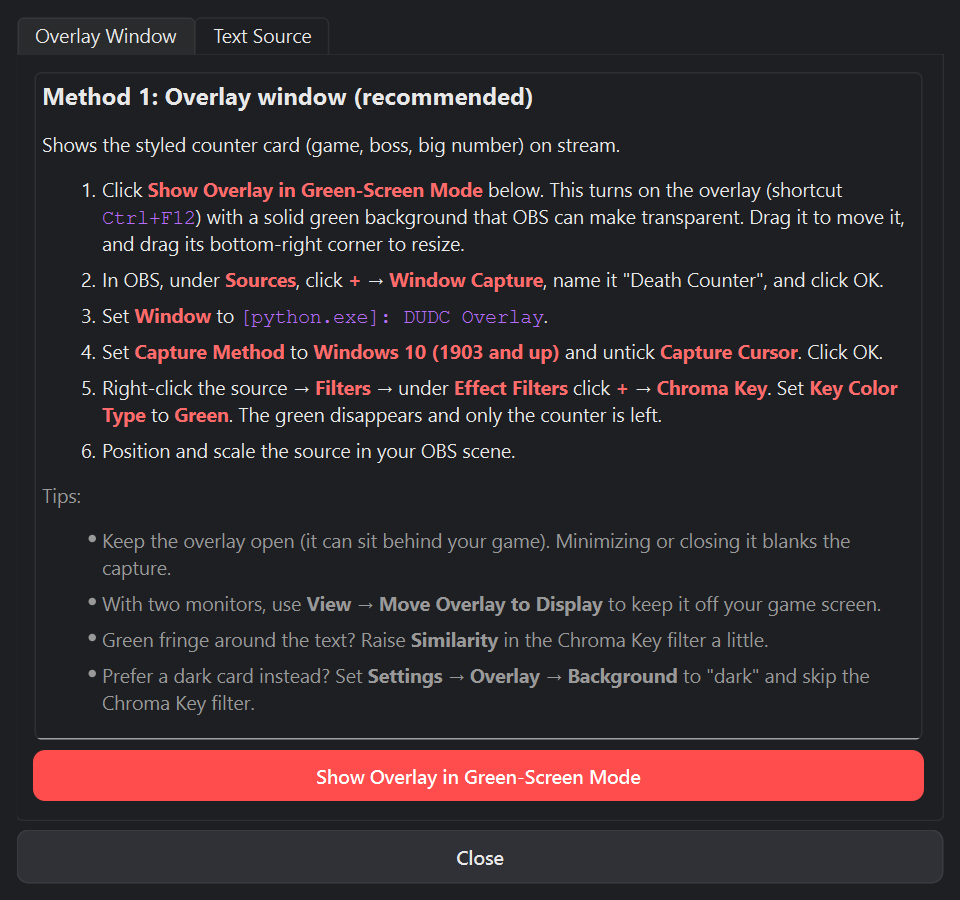
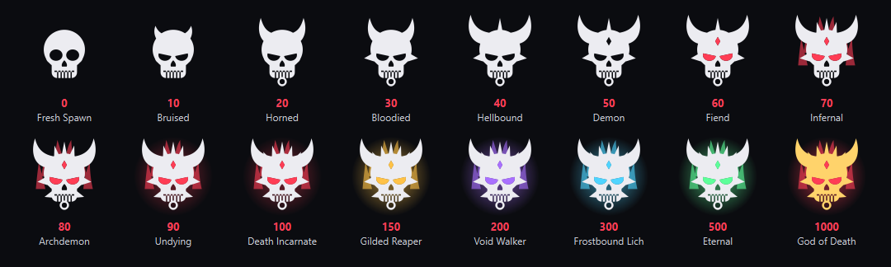

<p align="center">
  
</p>

<p align="center">
  <b>A free, lightweight death counter for Soulslike games and any other game: it counts your deaths <i>automatically</i>, grows a skull that evolves as you die, and it's built for streaming. Windows, Mac and Linux, and console games too.</b>
</p>

<p align="center">
  <a href="https://github.com/Jvn1604/UniversalDeathCounter/releases/latest"></a>
  <a href="https://github.com/Jvn1604/UniversalDeathCounter/actions/workflows/build-windows.yml"></a>
  <a href="https://github.com/Jvn1604/UniversalDeathCounter/actions/workflows/build-mac-linux.yml"></a>
  
  <a href="LICENSE"></a>
</p>

---

## Download

**[⬇ Download the latest release](https://github.com/Jvn1604/UniversalDeathCounter/releases/latest)**

| File | What it is |
|---|---|
| `UniversalDeathCounterSetup.exe` | **Installer (recommended).** Start Menu and desktop shortcuts, plus an uninstaller. |
| `UniversalDeathCounter-<version>-portable.zip` | **Portable.** Unzip anywhere and run `UniversalDeathCounter.exe`. Data is stored next to it. |
| `UniversalDeathCounter-<version>-macOS.dmg` | **Mac** (Apple Silicon, macOS 11+). Drag the app into Applications. |
| `UniversalDeathCounter-<version>-x86_64.AppImage` | **Linux** (and Steam Deck desktop mode). Make it executable (`chmod +x`), then run it. |

> **"Windows protected your PC"?** The app isn't code-signed yet, so Windows SmartScreen warns about unknown publishers. Click **More info → Run anyway**. The full source is here and every release is built by GitHub Actions from this repository.

No Python or anything else needed. Windows 10 or 11, macOS 11 or newer, or a 64-bit Linux desktop.

<details>
<summary><b>Mac and Linux notes</b></summary>

**Mac**
- The app isn't notarized by Apple yet. The first time, **right-click the app → Open → Open**.
- For auto-detect, allow **Screen Recording** when macOS asks (or later in System Settings → Privacy & Security → Screen Recording), then reopen the app.
- Hotkeys need no permission. F-keys control brightness and volume unless you hold **fn**, or turn on *Use F1, F2, etc. keys as standard function keys* in System Settings → Keyboard. In the app, Ctrl means ⌘.
- Controller combos aren't available on Mac yet; use the keys or the phone remote.

**Linux / Steam Deck**
- Works on X11 desktops, and on Wayland through XWayland: Proton and Wine games are X11 windows, so hotkeys and auto-detect work while they have focus.
- Pick the game's `.exe` inside the Proton prefix or `steamapps/common`, as on Windows; the app finds it even though it runs inside Wine.
- On a pure Wayland session (no XWayland) apps can't see other windows or hear keys, so use a controller combo, the phone remote, or read the game from OBS (Console page).
- Controllers are read from `/dev/input/js*`: Xbox, PlayStation, Steam Deck and most others work.
- Steam Deck Game Mode doesn't show other apps on top of the game; use Desktop Mode or the phone remote.

</details>

## Screenshots

<p align="center">
  
</p>
<p align="center">
  
  &nbsp;
  
</p>

| Auto death detection | Keyboard & controller bindings |
|---|---|
|  |  |
| **Statistics & graphs** | **Built-in OBS guide** |
|  |  |

## Features

### 💀 Automatic death detection
- **Add a game straight from its `.exe`** (or its `.app` on a Mac; Proton and Wine games on Linux work too). The app watches that game's window and counts a death whenever the death screen appears.
- **Works with any game.** Teach it the death screen once, either by pressing `F8` on the death screen or afterwards with **📷 Capture Screen…**, which lets you pick the frame from the last few seconds.
- **Zero setup for Souls games.** The built-in preset recognizes Elden Ring, Dark Souls I–III and Sekiro.
- **No death screen? Use the health bar.** Mark your health bar once at full health, and a death counts when it empties.
- **Or the game's log file.** For games that log deaths, such as Minecraft, it counts every new line that matches your text. This mode doesn't capture the screen at all.
- **Missed a death?** Add another death screen in two clicks. Any saved one counts.
- **Switches to the right game** when you launch it. A new session starts after a break of 16 hours or more; a restart, crash or update in between continues the same session, and the **Sessions** button next to Undo brings back any earlier one.
- **Screen capture only:** no memory reading and no injection, so it's safe with anti-cheat.

### 🎮 Controls, your way
- Global hotkeys work while the game is focused (defaults below), on Windows, Mac and Linux.
- **Xbox, PlayStation (DualShock 4 / DualSense), Steam Deck and most other controllers** on Windows and Linux. Bind a button combo such as *View/Share + D-pad Up*. One binding works on both kinds of pad.
- **Keybind editor with live conflict detection.** It flags duplicates, keys that would block typing, keys another program already took, and overlapping combos.

### ⏱ Speedrun timer
- **Splits per game.** Set them up on the **Timer** page (**Edit Splits**), or fill them from your boss list in one click.
- **Compares against your PB, your previous run, or your best segments:** a delta for every split (like `-12.42` or `+5.31`), the previous segment, **gold** for best-ever segments, plus your PB, sum of best and attempt count. A new PB is detected and announced automatically.
- **Real time and game time.** Game time leaves out loads and pauses. Choose which one the timer shows; the other appears underneath.
- **Pauses itself:** the whole timer pauses if the game closes or crashes. Game time also stops while the game is frozen, on black loading screens, and on pause, loading or cutscene screens you mark.
- **Never lose a run:** the run in progress is auto-saved every 10 seconds. After a crash, the next start offers to resume it or save it as an attempt.
- **Continue a reset run:** pick it in **Run History** and click **Continue This Run**. It comes back paused where it stopped, with its splits and deaths.
- **Run history and personal records** (**Timer → Run History & Records**): every attempt with its real time, game time and deaths; your PB, fewest-death run and best segments; and death records such as the fewest deaths to beat a boss.
- **Precision from seconds to milliseconds** (Settings → Speedrun).
- **Counts deaths per run**, including auto-detected ones, so you also see how many deaths your PB run had.
- **LiveSplit-style controls:** start/split, pause, undo, skip and reset, from hotkeys, a controller combo, or a right-click on the timer.
- **Its own OBS-ready window** (**Timer → Timer Window**, with an ON/OFF tag), styled like the overlay. It only redraws while a run is going.

### 💀 A skull that evolves as you die
Every 10 deaths your skull earns something new: horns, a nose ring, blades, a crown, a third eye, burning eyes, flames and an aura. Past 100 it changes colour, up to a golden **God of Death** at 1000. It sits next to the counter on Home (with how many deaths until the next one) and on the stream overlay.

<p align="center">
  
</p>

### 📺 Made for streaming
- **The overlay reads `DEATH - 12`** with your skull beside it and its name underneath (`THIS SESSION · BRUISED`). Turn the skull off from the overlay's right-click menu or its settings.
- **OBS-ready overlay, styled your way:** a card in any color, your own picture as the background, or green-screen mode for OBS's Chroma Key. Choose the font, number and text colors, size, corner roundness, opacity, a shadow that keeps text readable, and which lines show.
- **`deaths.txt`** for OBS Text sources, with your own template, e.g. `{game} - {boss}: {deaths}`.
- **OBS Setup** (sidebar) walks you through both methods, with one-click setup buttons.
- **Right-click the overlay** to count from it, switch what the big number shows, change the background or number size, lock it in place, keep it on top, or move it to another display. Double-click it for all its settings. The sidebar's **Overlay** entry shows whether it's ON or OFF.
- **Multi-monitor:** move the overlay to any display. Windows come back on-screen if a monitor is unplugged.

### 📊 Tracking & stats
- **The big number shows the game's all-time deaths** by default. Click the caption under it (or right-click the overlay) to show this session's, this boss's or **this speedrun run's** deaths instead; Home, the overlay and mini mode follow.
- **Continue a past session:** the **Sessions** button next to Undo lists every session of the game (when, how long, how many deaths). Pick one and keep counting in it.
- Session, boss and all-time counts, all at once, and they're independent: **Reset Session** starts a fresh session without touching the all-time total, and **Reset Total** zeroes the total without touching the session. Counts never go below zero.
- Switch bosses with the ◀ ▶ buttons or `Ctrl+F9` / `Ctrl+F10` from in-game. Defeated bosses are skipped.
- **Boss kills are detected too.** After your first boss of a game, use **Capture Screen** (Detection page) to teach it that game's victory banner (e.g. *GREAT ENEMY FELLED*). Every later kill of the selected boss then marks it **Defeated ✓**, keeps your "deaths until victory", selects the next boss, and can split the speedrun timer. There's also a **Boss Defeated** key (`Ctrl+F11`) for doing it by hand.
- Notes on individual deaths, session history, and graphs: per boss, over time, and per session.
- Ready-made boss lists for Elden Ring, Dark Souls III, Sekiro, Bloodborne, Hollow Knight and Cuphead.
- **Multiple profiles** (switch from the box at the top), JSON backup and restore, and CSV export.
- **Make the main window yours** in **Settings → Appearance**: any installed font (each shown in its own style), text and death-number colors, and a background image with adjustable dimming. **Changes preview live** as you edit, on the main window and the overlay; Cancel puts everything back.

### 🎮 PlayStation & Xbox
The **Console** page (sidebar) makes DUDC work when the game runs on a console:
- **Phone remote:** switch it on and open the link on your phone (same Wi-Fi). Big **+1**, Undo, boss and timer buttons, the live count, and no app to install. Only links with the secret key work, and **New Link** cuts off old ones. Windows may ask to allow network access the first time: allow private networks.
- **Auto-detect from a window:** pick the window the game shows in on this PC: **PS Remote Play**, the **Xbox app**, your capture card's app (e.g. Elgato 4K Capture Utility), or an **OBS Windowed Projector** of your capture card source. Death screens, the Souls preset, health bars, boss kills and timer auto-pause then read that window. Keep it visible: a minimized or covered window can't be read.
- **Read the capture card from OBS (best with a capture card):** in OBS turn on *Tools → WebSocket Server Settings → Enable WebSocket server*, then on the Console page enter the port and password (*Show Connect Info*), click **Connect** and pick your capture card source. DUDC asks OBS for a still of that source 5 times a second: nothing has to stay visible, and OBS keeps the card. Needs OBS 28 or newer (the WebSocket server is built in). No extra software is installed.

### 🎨 Themes
- **Phantom Dark** and **Daylight** are built in.
- **Glass** (frosted panels over a violet glow) and **Clay** (soft, puffy pastel buttons) are **downloaded only when you pick them** in Settings → Appearance (about 20 KB each, from this repository) and can be **uninstalled** again, so the install stays small.
- Every button has a clear icon ([Lucide](https://lucide.dev), ISC licence).

### ✨ Comfort
- **Home dashboard:** a friendly greeting with today's deaths, your skull and how far it is to the next one, this week's deaths per day (and versus last week), and boss progress with the bosses that killed you most.
- **Quick Start guide:** a checklist that ticks itself off as you go (add your game, count a death, add bosses, set up auto-detect, put it on stream), with a button on each step that takes you straight there. It also lists your keys and tips. Home shows how far along you are until you're done; reopen it any time with the **?** at the top.
- **Mini mode:** a tiny always-on-top window with the count, +1 and Undo, for one-monitor setups. Sidebar or tray.
- **Right-click the Game or Boss box** to rename it or mark the boss defeated, without opening Games & Bosses.
- **Tray menu** has +1, Undo, Boss Defeated, pause detection, start/split the timer, the timer window, mini mode and the overlay.
- **One place for everything:** pages and tools in the sidebar, profiles and backups at the top right. No duplicated menus.
- **One-click updates:** the card at the bottom of the sidebar shows whether you are up to date (checked at startup, every 6 hours, or with its refresh button). When a new version is out, click **Update**: the installed app downloads it, updates itself and reopens. (Portable copies, Mac and Linux open the download page.)
- Deleting a game tells you exactly what goes with it (deaths, bosses, sessions, runs).

### 🪶 Lightweight
- A 29 MB installer (about 100 MB installed), and **no** background services.
- Detection checks the game window 5 times a second and stops when the game isn't running.
- Controller polling only runs while a pad is connected.
- Your data is a local SQLite file, and nothing is uploaded. The only network requests are an optional update check against GitHub Releases and, if you pick Glass or Clay, that theme's download.

## Quick start

1. Install and open **DUDC**. The **Quick Start** checklist opens and ticks itself off as you go.
2. In the **Game** dropdown, choose **+ Add game from .exe…** and pick your game's `.exe` (for example `eldenring.exe`). On a Mac, pick the game's app; on Linux, the `.exe` in its Proton folder or the game's program.
3. Launch the game in **borderless or windowed** mode.
4. Die. 💀
   - **Souls games** are counted automatically.
   - **Any other game:** the first time, press `F8` on the death screen and drag a box around the death text. From then on deaths are counted automatically.
5. Streaming? Click **OBS Setup** in the sidebar.

You can always count by hand too: **+1 Death** (`F9`), **-1** (`F10`), **Undo** (`F11`).

## Default controls

| Action | Keyboard | Controller |
|---|---|---|
| +1 Death | `F9` | not set |
| -1 Death | `F10` | not set |
| Undo | `F11` | not set |
| Toggle overlay | `Ctrl+F12` | not set |
| Calibrate death screen | `F8` | not set |
| Pause / resume auto-detect | `Ctrl+F8` | not set |
| Previous / next boss | `Ctrl+F9` / `Ctrl+F10` | not set |
| Boss defeated | `Ctrl+F11` | not set |
| Timer: start / split | `Num 1` | not set |
| Timer: pause / reset | `Num 5` / `Num 3` | not set |
| Timer: undo / skip split | `Num 8` / `Num 2` | not set |

The timer keys use the number pad, as in LiveSplit, so **Num Lock must be on**. No number pad? Rebind them. Only Start / Split is held all the time; pause, reset, undo and skip are claimed only while a run is going, so the number pad keeps working in other apps the rest of the time.

To change any of them, go to **Settings → Preferences… → Controls**:
- **Keyboard:** click a field and press a key.
- **Controller:** click **Record**, then hold a button combo and release it.

Controller presses also reach the game, so use a combo, not a single button.

## Auto death detection: how it works

Pick a method per game on the **Detection** page (**Set Up Detection**):

| Method | Best for | Setup |
|---|---|---|
| **Calibrated death screen** | Any game with a death screen | Press `F8` on the death screen and box the death text |
| **Souls preset** | Elden Ring, Dark Souls I–III, Sekiro | None |
| **Health bar empties** | Games without a death screen | At full health, press `F8` and box your health bar |
| **Game log file** | Games that write deaths to a log (e.g. Minecraft) | Choose the log file and the death text, then click **Test** |

**Death screens:** DUDC grabs the game's window a few times per second. It compares the area where the death text appears with the death screens you've saved, using a contrast-independent image match, so fade-ins and brightness changes don't matter.

**Health bar:** a death counts when the bar stays empty for a second *after your health was already below about 60%*. That's why opening a menu or map, which hides the HUD at full health, never counts. The catch: a one-hit kill from high health is missed, so press `F9` for those. Death screens you add still count in this mode too.

**Log file:** each new line matching your text is one death. Lines already in the file when detection starts are skipped, and a new log from the next game launch is followed automatically. The text is a case-insensitive regular expression, so `|` separates alternatives. In Minecraft, for example, use `latest.log` in `%APPDATA%\.minecraft\logs` with `YourName (was slain|died|fell|drowned|burned|blew up)`. In multiplayer, include your name so other players' deaths don't count.

To keep the count accurate:
- **No double counting:** a death needs about half a second of death screen, and a long death screen counts once.
- **Cooldown:** a short gap between deaths is enforced (8 s by default, adjustable).
- **Pause** with `Ctrl+F8` for cutscenes, co-op, or watching someone else play.
- **Calibrate tightly:** box just the death text (like "YOU DIED"), not the game world behind it.

**Supported:** any game with a consistent death screen, a visible health bar, or a log that records deaths. Elden Ring, Dark Souls I–III and Sekiro work with no setup.

**Limitations:**
- Exclusive-fullscreen games may capture as black. Switch to borderless or windowed mode; the app tells you if this happens.
- Games with no death screen, no health bar and no death log can't be detected. Use the hotkeys there.
- The Souls preset is a color heuristic. If it ever misfires, calibrate that game instead.

## Troubleshooting

**A hotkey doesn't work / "Hotkey unavailable"**
Another program has already registered that key. On many PCs plain `F12` is taken. Pick another key in **Settings → Controls**; the editor warns you as you type.
- **Mac:** F-keys need **fn** unless you turn on standard function keys (System Settings → Keyboard).
- **Linux:** a pure Wayland session doesn't allow global keys; see the Mac and Linux notes under Download.

**Deaths aren't detected**
1. Check the status line under the game selector. It should say *"Watching <game>.exe for deaths"*.
2. If it says the capture is **black**, switch the game to borderless or windowed mode. On a Mac, allow Screen Recording for the app; on a Wayland desktop, read the game from OBS instead.
3. If it's watching but misses deaths, use **📷 Capture Screen…** right after a death to add that screen.

**The overlay shows a green box in OBS**
Add a **Chroma Key** filter to the source (Key Color Type: Green). See **OBS Setup** in the sidebar.

**My antivirus complains**
False positives happen with unsigned apps. DUDC uses the system's own hotkey API (no keyboard hook) and ships as a normal folder build to keep this to a minimum. You can check every build's source and logs under [Actions](https://github.com/Jvn1604/UniversalDeathCounter/actions).

**Where is my data?**
- **Mac:** `~/Library/Application Support/UniversalDeathCounter/saves/`
- **Linux:** `~/.local/share/UniversalDeathCounter/saves/`
- **Installer:** `%APPDATA%\UniversalDeathCounter\saves\`
- **Portable:** the `saves` folder next to the exe.

**Save and load your progress:**
- **⋮ (top right) → Save Progress… (Ctrl+S)** saves everything to one file, including the session and speedrun run in progress. Copy it anywhere: another PC, a reinstall, a backup drive.
- **⋮ → Load Save…** brings it back and carries on with that session and run (the run comes back paused). Replace swaps your data for the save's (yours is saved first); Add puts its games next to yours. Older backups load too.
- **Auto-save:** every 5 minutes and when you close the app, to `Saved Progress` in the data folder above.
- **Closing asks first**, and your progress is already saved by the time it asks. Turn the question off in Settings → General.

## Build from source

Requires Python 3.12+ on Windows, macOS or Linux. The table uses Windows paths; on Mac and Linux use `venv/bin/` instead of `.\venv\Scripts\`.

```powershell
git clone https://github.com/Jvn1604/UniversalDeathCounter.git
cd UniversalDeathCounter
python -m venv venv
.\venv\Scripts\pip install -r requirements.txt
.\venv\Scripts\python -m src.app
```

On a Mac or Linux:

```bash
python3 -m venv venv
venv/bin/pip install -r requirements.txt
venv/bin/python -m src.app
```

| Task | Command |
|---|---|
| Run tests | `.\venv\Scripts\python -m pytest` |
| Lint and conflict-marker checks | `.\venv\Scripts\pre-commit run --all-files` (or `pre-commit install` once to run them on every commit) |
| Build the app folder | `.\venv\Scripts\pyinstaller packaging\UniversalDeathCounter.spec` → `dist\UniversalDeathCounter\` |
| Build the installer | `iscc packaging\installer.iss` ([Inno Setup 6](https://jrsoftware.org/isinfo.php)) |
| Build the Mac app / Linux AppImage | the same `pyinstaller` command on that OS (`dist/UniversalDeathCounter.app`), then `packaging/make_appimage.sh <version>` on Linux |
| Regenerate icons / screenshots (incl. the skull tiers) | `python packaging\make_icons.py` / `python packaging\make_screenshots.py` |

**Releasing:**
1. Bump `APP_VERSION` in `src/utils/constants.py`.
2. Merge to `main`.
3. Push a matching tag such as `v2.11.0`.

GitHub Actions then tests on all three systems, builds the installer, portable zip, Mac .dmg and Linux AppImage, and publishes the release. If the repository secrets are set, it also code-signs them; see [docs/code-signing.md](docs/code-signing.md).

<details>
<summary><b>Project structure</b></summary>

```
src/
├── app.py            # Entry point
├── core/             # Counter, session and statistics logic
├── database/         # SQLite layer (the only module with SQL)
├── detection/        # Window lookup per OS, capture, death-screen matchers, OBS client
├── hotkeys/          # Global hotkeys (Windows, macOS, X11), controllers, conflicts
├── overlay/          # OBS overlay window
├── ui/               # Main window, Home dashboard, skulls, Quick Start guide, dialogs
├── themes/           # Built-in stylesheets (Phantom Dark, Daylight) + theme catalog
└── utils/            # Constants, platform info, profiles, startup, phone remote, updater
packaging/            # PyInstaller spec, Inno Setup script, AppImage script, signing, icon/screenshot tools
themes/               # Downloadable themes (Glass, Clay), fetched by the app on request
tests/                # pytest suite (320+ tests, run on Windows, macOS and Linux)
```

Design notes:
- **Event-sourced counting:** every +1 and -1 is a row with a signed `delta`, so undo, history and graphs come for free.
- **Detection only reads the screen** through pure-numpy matchers, so it's unit tested without a game.
- **No heavy dependencies:** PySide6, numpy, mss and psutil. The OS APIs (hotkeys, controllers, window lookup: Win32, Carbon/Quartz on macOS, X11 and the kernel's joystick devices on Linux) are called directly through `ctypes`.

</details>

## Roadmap

- [x] Automatic death detection with per-game calibration and a Souls preset
- [x] Xbox and PlayStation controller bindings, plus a keybind editor with conflict detection
- [x] Multi-monitor support, and an OBS setup guide
- [x] Speedrun timer with splits, PB comparison, run history and crash recovery
- [x] Console players: phone remote, window capture and OBS capture-card reading
- [x] Evolving skull, Home dashboard and Quick Start guide
- [x] macOS and Linux (including Steam Deck desktop mode)
- [ ] Controller combos on macOS
- [ ] More presets (Hollow Knight / Silksong, Lies of P, Cuphead) and shareable preset files
- [ ] Live detection score and sensitivity slider
- [ ] Fullscreen capture via Windows Graphics Capture

Ideas and bug reports are welcome in [Issues](https://github.com/Jvn1604/UniversalDeathCounter/issues).

## Contributing

1. Fork the repo and create a branch.
2. Run `pre-commit install` once so commits are checked for lint errors and leftover merge-conflict markers.
3. Add tests for logic changes and make sure `pytest` passes.
4. Open a pull request explaining what changed and why.

## License

[MIT](LICENSE) © Jeeventhiran Sivanantham
